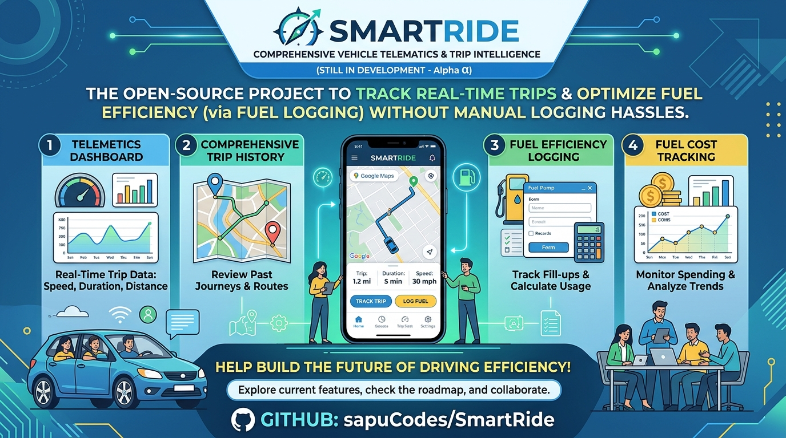

# SmartRide 🛵🚗

SmartRide is a feature-rich mobile vehicle telematics, trip tracking, and fuel efficiency management application built with **Flutter**. Designed to help drivers effortlessly monitor their journeys, optimize fuel consumption, and analyze driving metrics in real-time.


---

## ✨ Key Features

* **🗺️ Real-Time Trip Tracking:** Integrated with the Google Maps SDK to accurately record routes, calculate travel distance, and map paths in real-time.
* **⛽ Fuel Efficiency Management:** Log fuel fill-ups, calculate mileage efficiency (cost per distance/fuel consumption rates), and monitor overall spending.
* **📊 Telematics & Analytics Dashboard:** View comprehensive trip statistics, average speeds, travel history, and efficiency trends at a glance.
* **⚡ Reactive State Management:** Powered by the `provider` package to ensure smooth, responsive UI updates across the entire application workflow.

---

## 🛠️ Tech Stack

* **Framework:** [Flutter](https://flutter.dev/) (Cross-platform mobile development)
* **Language:** [Dart](https://dart.dev/)
* **Maps & Geolocation:** Google Maps SDK for Flutter, Geolocator
* **State Management:** Provider

---

## 🚀 Getting Started

### Prerequisites

Make sure you have the following installed on your development machine:
* Flutter SDK (`>=3.x.x`)
* Dart SDK
* Android Studio / VS Code with Flutter extensions
* A valid Google Maps API Key (configured for both Android and iOS)

### Installation & Setup

1. **Clone the repository:**
   ```bash
   git clone [https://github.com/sapuCodes/SmartRide.git](https://github.com/sapuCodes/SmartRide.git)
   cd SmartRide


-------------------------------------------------
A clean architecture Flutter mobile application.

## Project Structure

```
lib/
├── config/           # Configuration files (themes, constants)
├── models/           # Data models and entities
├── screens/          # App screens/pages
├── services/         # Business logic and external services
├── widgets/          # Reusable custom widgets
├── utils/            # Utility functions and helpers
└── main.dart         # App entry point
```

## Architecture Principles

- **Separation of Concerns**: Each layer has a specific responsibility
- **Reusability**: Common widgets and utilities are centralized
- **Maintainability**: Clear folder structure makes code easy to locate and modify
- **Scalability**: New features can be added without affecting existing code

## Quick Start

1. Install dependencies:
   ```bash
   flutter pub get
   ```

2. Run the app:
   ```bash
   flutter run
   ```

## Theme Configuration

The app uses Material Design 3 with custom theme configuration in `lib/config/theme.dart`.

- Light theme for light mode
- Dark theme for dark mode
- System theme mode detection
=======
Intelligent Vehicle Companion for  Fuel, Trips, and Efficiency 
>>>>>>> b8d5704f46ff207e1ecf167bf1df07eb13554358
